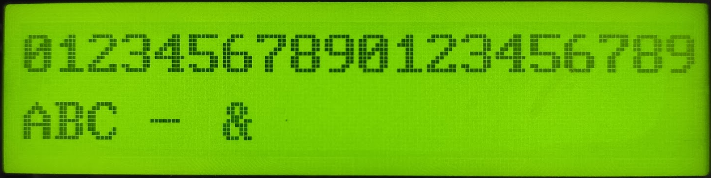

# STM32F1-LCD16032

Articles: [Cesky](blog/index.cs.md) | [English](blog/index.en.md) | [Website](https://codeleccz.github.io/codelec.web/en/blog/stm32f1-lcd16032/)

## Project overview

`STM32F1-LCD16032` drives a **WG16032D3** graphic LCD (160x32 pixels, **ST7920** controller) from an **STM32F103C8Tx** (64 kB Flash, 20 kB SRAM). The project is generated with CubeMX/HAL for STM32CubeIDE and uses the 8-bit parallel interface on plain GPIO.

Two display modes are available (select with `#define U8G2` in `Core/Src/main.c`):

- `0` - built-in display fonts through the minimal driver in `Core/Src/ST7920.c`
- `1` - the u8g2 graphics library (`Middlewares/u8g2`) with a frame buffer, fonts, lines and UTF-8 text

## Hardware pinout (STM32F103C8Tx -> WG16032D3)

| LCD signal | STM32 pin |
|---|---|
| `LCD_DB0` | `PA7` |
| `LCD_DB1` | `PA2` |
| `LCD_DB2` | `PA6` |
| `LCD_DB3` | `PA10` |
| `LCD_DB4` | `PB1` |
| `LCD_DB5` | `PA1` |
| `LCD_DB6` | `PB0` |
| `LCD_DB7` | `PA8` |
| `LCD_RS` | `PB12` |
| `LCD_RW` | `PA0` (held low, write only) |
| `LCD_EN` | `PA5` |

ST7920 parallel mode requires the `PSB` pin pulled high. SWD uses `PA13`/`PA14`.

## Clock and peripherals

- HSE oscillator, PLL `x9`, `SYSCLK = HCLK = 72 MHz`, `APB1 = 36 MHz`
- `TIM1` (internal clock) is the microsecond time base for `HAL_Delay_us()` / `HAL_Delay_ms()` in `Core/Src/delay.c`
- All LCD pins are high speed GPIO outputs

## Build, flash, and test

1. Open `STM32F1-LCD16032.ioc` / the project in STM32CubeIDE
2. Select the display mode in `Core/Src/main.c`
3. Build and flash via ST-LINK
4. Check the test text on the display

## Documentation

- `Documents/WG16032D3.pdf` - display datasheet
- `Documents/GLCD/ST7920.pdf` - controller datasheet
- `Documents/WG16032D3 wirring.jpg` - wiring photo

## Images

