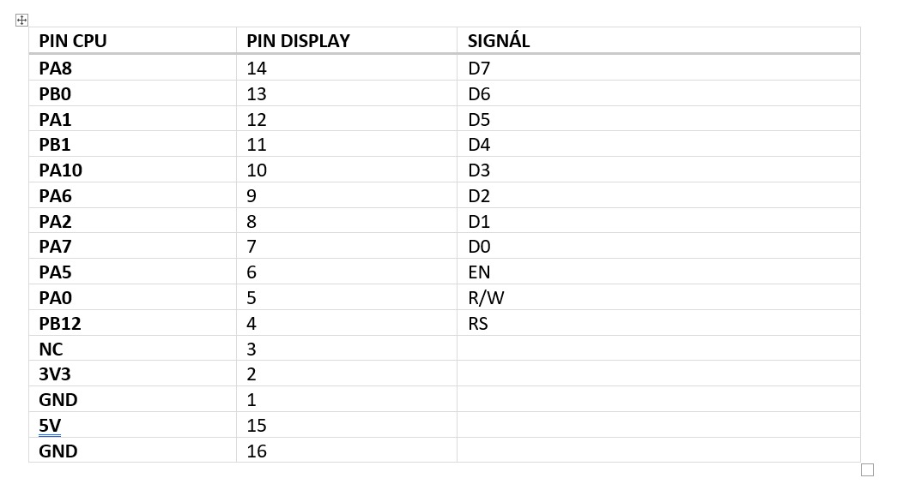
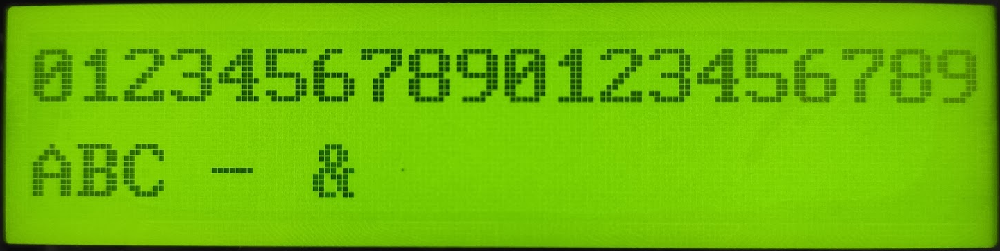

# Přehled projektu

`STM32F1-LCD16032` řídí grafický LCD **WG16032D3** (160x32 bodů, řadič **ST7920**) z mikrokontroléru **STM32F103C8Tx**. Projekt je vygenerován v CubeMX/HAL pro STM32CubeIDE a displej obsluhuje přes 8bitové paralelní rozhraní pomocí běžných GPIO.

Obsah lze zobrazit dvěma způsoby:

1. **Vestavěný textový režim** - minimální ovladač v `Core/Src/ST7920.c` zapisuje znaky do textové RAM řadiče a používá vlastní font displeje.
2. **Režim u8g2** - grafická knihovna u8g2 (v `Middlewares/u8g2`) s framebufferem, fonty, čarami a UTF-8 textem, zapíná se makrem `U8G2` v `Core/Src/main.c`.

# Zapojení pinů (STM32F103C8Tx -> WG16032D3)

Přiřazení pinů podle `STM32F1-LCD16032.ioc`:

| Signál LCD | Pin STM32 | Poznámka |
|---|---|---|
| `LCD_DB0` | `PA7` | datový bit 0 |
| `LCD_DB1` | `PA2` | datový bit 1 |
| `LCD_DB2` | `PA6` | datový bit 2 |
| `LCD_DB3` | `PA10` | datový bit 3 |
| `LCD_DB4` | `PB1` | datový bit 4 |
| `LCD_DB5` | `PA1` | datový bit 5 |
| `LCD_DB6` | `PB0` | datový bit 6 |
| `LCD_DB7` | `PA8` | datový bit 7 |
| `LCD_RS` | `PB12` | volba registru |
| `LCD_RW` | `PA0` | čtení/zápis, trvale v log. 0 (jen zápis) |
| `LCD_EN` | `PA5` | strobe enable |
| SWD | `PA13` / `PA14` | programování a ladění |

ST7920 pracuje v paralelním režimu, když je pin `PSB` v log. 1. Fotografie zapojení a datasheety displeje jsou v adresáři `Documents/`.

# Konfigurace hodin a periferií

- Externí oscilátor HSE na `PD0/PD1`, PLL `x9`
- `SYSCLK = HCLK = 72 MHz`, `APB1 = 36 MHz`
- Hodiny USB `48 MHz` z PLL (předdělička `/1,5`)
- `TIM1` s interními hodinami, použit jako mikrosekundová časová základna
- Všechny piny LCD jsou GPIO výstupy s vysokou rychlostí

# Moduly firmware

## 1) Zpoždění (`Core/Src/delay.c`)

`HAL_Delay_us()` a `HAL_Delay_ms()` čekají aktivně na čítači `TIM1`. Delší zpoždění, než dovolí 16bitový čítač, se rozdělí na několik kroků. ST7920 vyžaduje zpoždění v desítkách mikrosekund, které `HAL_Delay()` neposkytne.

## 2) Ovladač ST7920 (`Core/Src/ST7920.c`)

- `LCD_WriteCmd()` / `LCD_WriteData()` nastaví `RS`, vystaví bajt na `DB0..DB7` a vygenerují strobe `EN` s `DELAY_LCD_EN_US` (10 us); změna `RS` přidá `DELAY_LCD_RS_US` (50 us)
- `LCD_Init()` provede inicializační sekvenci: function set `0x30` dvakrát, display on `0x0C`, clear `0x01`, entry mode `0x06`
- `LCD_PutStr(x, y, text)` nastaví adresu DDRAM a zapíše řetězec vestavěným fontem displeje

## 3) Integrace u8g2

`u8g2_gpio_and_delay_stm32()` je callback pro u8g2, který mapuje zprávy u8x8 (`GPIO_D0..D7`, `GPIO_E`, `GPIO_DC`, zpoždění) na GPIO piny a funkce zpoždění. Displej se inicializuje pomocí `u8g2_Setup_st7920_p_192x32_f()` a `u8x8_byte_8bit_6800mode`, což využívá framebuffer.

Příklad v `main.c` vykreslí vodorovné čáry a tři řádky textu fontem `u8g2_font_6x12_te` včetně české diakritiky a pak odešle buffer funkcí `u8g2_SendBuffer()`.

# Sestavení, nahrání a test

1. Otevřete projekt `STM32F1-LCD16032` v STM32CubeIDE
2. V `Core/Src/main.c` zvolte režim: `#define U8G2 0` pro vestavěné fonty, `1` pro u8g2
3. Sestavte a nahrajte přes ST-LINK (SWD na `PA13/PA14`)
4. Zapojte displej podle tabulky výše. Ve vestavěném režimu se na druhém řádku každých 200 ms zvětší znak; v režimu u8g2 se zobrazí testovací text a čáry

# Poznámky

- Inicializace u8g2 používá variantu ST7920 192x32, viditelná oblast WG16032D3 je 160x32 bodů
- Konstanty zpoždění v `ST7920.c` byly odladěny pro tento displej, pro jiné moduly mohou být potřeba delší
- Dokumentace displeje: `Documents/WG16032D3.pdf`, `Documents/GLCD/ST7920.pdf`

# Obrázky

