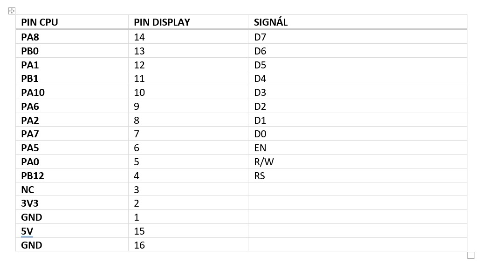
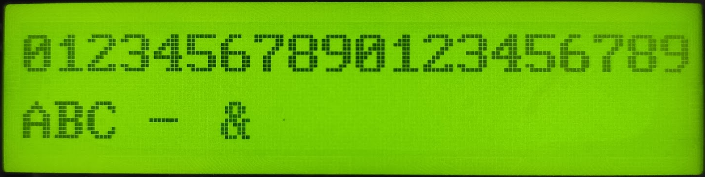

# Project overview

`STM32F1-LCD16032` drives a **WG16032D3** graphic LCD (160x32 pixels, **ST7920** controller) from an **STM32F103C8Tx**. The project is generated with CubeMX/HAL for STM32CubeIDE and drives the display through the 8-bit parallel interface using plain GPIO.

There are two ways to show content:

1. **Built-in text mode** - a minimal driver in `Core/Src/ST7920.c` writes characters into the controller's text RAM using the display's own font.
2. **u8g2 mode** - the u8g2 graphics library (in `Middlewares/u8g2`) with a frame buffer, fonts, lines and UTF-8 text, enabled with the `U8G2` macro in `Core/Src/main.c`.

# Hardware pinout (STM32F103C8Tx -> WG16032D3)

Pin mapping from `STM32F1-LCD16032.ioc`:

| LCD signal | STM32 pin | Note |
|---|---|---|
| `LCD_DB0` | `PA7` | data bit 0 |
| `LCD_DB1` | `PA2` | data bit 1 |
| `LCD_DB2` | `PA6` | data bit 2 |
| `LCD_DB3` | `PA10` | data bit 3 |
| `LCD_DB4` | `PB1` | data bit 4 |
| `LCD_DB5` | `PA1` | data bit 5 |
| `LCD_DB6` | `PB0` | data bit 6 |
| `LCD_DB7` | `PA8` | data bit 7 |
| `LCD_RS` | `PB12` | register select |
| `LCD_RW` | `PA0` | read/write, held low (write only) |
| `LCD_EN` | `PA5` | enable strobe |
| SWD | `PA13` / `PA14` | programming and debug |

The ST7920 is in parallel mode when its `PSB` pin is pulled high. The wiring photo and the display datasheets are in `Documents/`.

# Clock and peripheral configuration

- External HSE oscillator on `PD0/PD1`, PLL `x9`
- `SYSCLK = HCLK = 72 MHz`, `APB1 = 36 MHz`
- USB clock `48 MHz` from the PLL (`/1.5` prescaler)
- `TIM1` with internal clock, used as a microsecond time base
- All LCD pins are GPIO outputs with high speed

# Firmware modules

## 1) Delays (`Core/Src/delay.c`)

`HAL_Delay_us()` and `HAL_Delay_ms()` busy-wait on the `TIM1` counter. Delays longer than the 16-bit counter range are split into several steps. The ST7920 needs delays in the tens of microseconds, which `HAL_Delay()` cannot provide.

## 2) ST7920 driver (`Core/Src/ST7920.c`)

- `LCD_WriteCmd()` / `LCD_WriteData()` set `RS`, put one byte on `DB0..DB7` and strobe `EN` with `DELAY_LCD_EN_US` (10 us); changing `RS` adds `DELAY_LCD_RS_US` (50 us)
- `LCD_Init()` runs the initialisation sequence: function set `0x30` twice, display on `0x0C`, clear `0x01`, entry mode `0x06`
- `LCD_PutStr(x, y, text)` sets the DDRAM address and writes a string in the display's built-in font

## 3) u8g2 integration

`u8g2_gpio_and_delay_stm32()` is the u8g2 callback that maps u8x8 messages (`GPIO_D0..D7`, `GPIO_E`, `GPIO_DC`, delays) to the GPIO pins and the delay functions. The display is set up with `u8g2_Setup_st7920_p_192x32_f()` and `u8x8_byte_8bit_6800mode`, which uses the frame buffer.

The example in `main.c` draws horizontal lines and three lines of text with the `u8g2_font_6x12_te` font, including Czech diacritics, then sends the buffer with `u8g2_SendBuffer()`.

# Build, flash, and test

1. Open the `STM32F1-LCD16032` project in STM32CubeIDE
2. Choose the mode in `Core/Src/main.c`: `#define U8G2 0` for built-in fonts, `1` for u8g2
3. Build and flash through ST-LINK (SWD on `PA13/PA14`)
4. Wire the display as in the table above. In built-in mode the second line shows an incrementing character every 200 ms; in u8g2 mode the test text and lines appear

# Notes

- The u8g2 setup uses the 192x32 ST7920 variant; the visible area of the WG16032D3 is 160x32 pixels
- Delay constants in `ST7920.c` were tuned for this display and may need to be longer for other modules
- Display documentation: `Documents/WG16032D3.pdf`, `Documents/GLCD/ST7920.pdf`

# Images

